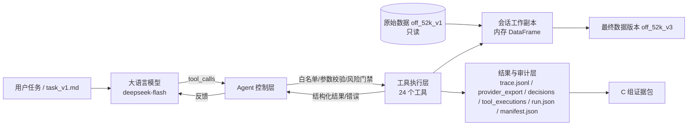

# 任务三：大模型选型与 Agent 架构设计报告

> 对应课程文档「步骤三：大模型选型与 Agent 架构设计方案」。
> 本报告中的模型调用、Token、费用与工具执行均来自真实 DeepSeek API 运行，不使用模拟响应。
> 项目根目录：`data_mining`；主运行：`outputs/agent_runs/agent_20261030_demo03`。

## 1. 阶段目标与交付物

### 1.1 五项核心任务对照

| 文档任务 | 本阶段实现 | 主要产物 |
| --- | --- | --- |
| 1. 大模型选型 | 候选模型对比 + 同任务实测 + 价格核算 | `config/agent/models.json`、本报告第 2 节 |
| 2. Agent 架构选择 | 单智能体 + ReAct 式工具调用 + 固定验证关卡 | `src/data_agent/agent/`、第 3 节架构图 |
| 3. 接入 Python 工具 | 24 个工具统一注册，覆盖四大模块 | `src/data_agent/agent/tools.py`、第 4 节 |
| 4. 提示词与参数设计 | 版本化系统/任务提示词、模型参数档案 | `config/agent/prompts/`、`config/agent/models.json` |
| 5. 控制与日志记录 | 白名单、参数校验、风险门禁、循环终止、Token/费用 | `control.py`、`trace.py`、`outputs/agent_runs/*` |

### 1.2 代码与运行入口

| 文件 | 职责 |
| --- | --- |
| `src/data_agent/agent/models.py` | 模型档案、价格快照、项目路径 |
| `src/data_agent/agent/provider.py` | OpenAI 兼容 Chat Completions 客户端，工具调用、重试、原始响应 |
| `src/data_agent/agent/session.py` | 只读原始数据 + 内存工作副本 + 每步 Parquet 哈希 + 最终版本落盘 |
| `src/data_agent/agent/tools.py` | 24 个工具的 JSON Schema 与执行适配 |
| `src/data_agent/agent/control.py` | 工具白名单、参数校验、风险门禁、重复调用拦截、执行记录 |
| `src/data_agent/agent/runner.py` | ReAct 主循环、结束关卡、报告、清单与哈希 |
| `src/data_agent/agent/trace.py` | JSONL 追踪、Provider 回执、Token/费用核算 |
| `src/data_agent/agent/prompts.py` | 提示词加载与内容哈希 |
| `src/data_agent/agent/bundle.py` | 第四部分 C 组证据包 |
| `scripts/run_agent.py` | 命令行入口；`python -m data_agent.agent` 需先把 `src` 加入 PYTHONPATH |

## 2. 大模型选型

### 2.1 候选与比较维度

| 维度 | 说明 | 本项目实测方式 |
| --- | --- | --- |
| 工具调用正确性 | 是否按 schema 选对工具与参数 | 真实执行 24 个工具，统计错误码 |
| 指令遵循 | 是否遵守“先检测后清洗、聚类前不再清洗、报告简短”等约束 | 检查实际调用序列 |
| 多轮稳定性 | 能否接收错误反馈并自我修正 | 连续任务 + 失败重试记录 |
| 成本 | 输入/输出 Token 与单价 | 按 API 返回 usage 与官方价格计算 |
| 部署与接入 | OpenAI 兼容接口、Function Calling | 实际 HTTP 调用 |

候选模型：

- **DeepSeek-V4.1-Flash**（API 名称 `deepseek-flash`，文档版本 `DeepSeek-V4.1-Flash-1017`）
- **DeepSeek-V4-Pro**（`deepseek-v4-pro`，`DeepSeek-V4-Pro-0813`）
- **通义千问 Plus**（DashScope OpenAI 兼容模式，`qwen-plus`）

价格（USD / 1M tokens，DeepSeek 官方页 2026-10-30 核对）：

| 模型 | 输入（缓存命中） | 输入（缓存未命中） | 输出 | 备注 |
| --- | --- | --- | --- | --- |
| deepseek-flash | 0.006（峰值） | 0.30（峰值） | 1.20（峰值） | 低谷价为峰值一半 |
| deepseek-v4-pro | 0.044（峰值） | 1.32（峰值） | 3.96（峰值） | 约为 flash 的 3–4 倍 |
| qwen-plus | 未核对 | 未核对 | 未核对 | 本次无 DashScope 密钥，未实测 |

### 2.2 相同测试任务

为公平比较，使用同一份数据、同一套工具、同一控制层、同一提示词，只改变模型：

- **全量任务** `task_v1.md`：检测 → 清洗 → 验证 → 聚类（k=3、k=5）→ 报告，数据 52,000 行。
- **基线探针任务** `task_probe_v1.md`：固定最小链路（3 项检测 + 去重 + 1 个缺失列中位数 + 验证 + k=5 聚类 + 报告），预算 16 轮。

### 2.3 实测结果

| 运行 | 模型 | 任务 | 状态 | 模型调用 | 工具调用 | 工具错误 | 输入/输出 Token | 费用 USD | 耗时 |
| --- | --- | --- | --- | --- | --- | --- | --- | --- | --- |
| demo03 | deepseek-flash | 全量 | completed | 18 | 44 | 1 | 454,209 / 5,852 | 0.0188 | 325.5 s |
| probe_flash_01 | deepseek-flash | 探针 | completed | 11 | 13 | 0 | 154,841 / 1,308 | 0.0076 | 93.1 s |
| probe_v4pro_01 | deepseek-v4-pro | 探针 | completed | 9 | 13 | 0 | 121,982 / 1,003 | 0.0320 | 60.2 s |

探针任务允许模型“任选一个缺失列”，两个模型的选择不同（flash 选 `fiber_100g`，v4-pro 选 `proteins_100g`），
因此两次聚类的指标不能横向比较；探针对比只用于工具调用正确性、轮数、Token、费用与耗时。

补充稳定性证据（同一模型、同一任务、不同预算）：

| 运行 | 预算 | 状态 | 模型调用 | 工具调用 | 费用 | 失败原因 |
| --- | --- | --- | --- | --- | --- | --- |
| demo01 | 24 轮 | budget_exhausted | 24 | 49 | 0.0251 | 清洗步骤多，聚类评价前耗尽轮数 |
| demo02 | 36 轮 | budget_exhausted | 36 | 58 | 0.0360 | 报告 JSON 被 max_tokens 截断，5 次重试仍失败 |
| demo03 | 36 轮 | completed | 18 | 44 | 0.0188 | — |

### 2.4 选型结论

- **主用模型**：`deepseek-flash`（DeepSeek-V4.1-Flash-1017）。理由：Function Calling 稳定、支持 1M 上下文、价格最低；在相同控制层下可完成 21 步清洗 + 7 个 k 的聚类评价 + 报告，单次全量任务费用不到 2 美分。
- **备用模型**：`deepseek-v4-pro`。探针任务中它用 9 轮完成（flash 11 轮），耗时 60.2 s（flash 93.1 s），但费用 $0.0320 是 flash 的 4.2 倍。适合更复杂的多轮推理；本项目以成本优先，故选 flash 为主。
- 两模型在相同探针任务上均 0 工具错误、均完成全部规定步骤，说明控制层与工具契约不依赖某个特定模型。
- **Qwen**：保留为候选 profile（`qwen-plus`），但因本次没有 DashScope 密钥，**不写入任何实测结论**；接入只需设置 `DASHSCOPE_API_KEY` 并切换 `--profile`。
- 所有价格只用于“按官方单价换算费用”，不用于训练或推断；实际账单以服务商为准。

## 3. Agent 架构

### 3.1 总体架构



| 层 | 职责 | 对应实现 |
| --- | --- | --- |
| 大语言模型层 | 分析检测结果、选择工具与策略、解释决策 | DeepSeek Chat Completions + Function Calling |
| Agent 控制层 | 解析调用、校验工具名/参数/权限、执行、反馈、限制轮数 | `control.py` |
| 工具执行层 | ①质量检测 ②清洗预处理 ③营养聚类 ④验证评价 | `tools.py` |
| 结果与审计层 | 原始数据、工作版本、操作记录、指标、Token、费用 | `session.py`、`trace.py`、`runner.py` |

### 3.2 执行流程（ReAct + 固定验证关卡）

```
system prompt + task prompt
        ↓
[模型] → tool_calls → [控制层校验] → [工具执行] → tool message → [模型]
        ↑                                                    │
        └────────────── 最多 max_steps 轮 ────────────────────┘
        ↓ submit_final_report 被接受
persist_final() → 最终数据集 + 报告 + C 组证据包
```

固定关卡（不交给模型自由决定）：

1. **工具白名单**：只允许注册表中的 24 个工具，未知工具直接拒绝。
2. **参数校验**：按 JSON Schema 校验类型、必填、枚举、范围、未知字段；非法参数返回 `invalid_arguments`。
3. **风险门禁**：`drop_row`、`quarantine_row`、`custom_resolver` 等危险策略默认拒绝，除非运行参数显式 `--dangerous-policy allow`。
4. **保留率护栏**：单步删除超过当前行数 10% 直接拒绝；最终保留率低于 50% 不允许提交。
5. **重复调用拦截**：相同工具 + 相同参数第二次调用返回 `duplicate_call`，防止模型陷入循环。
6. **结束关卡**：必须满足 ①至少 1 次清洗 ②最后一次清洗后已 `validate_quality` ③至少 1 个 k 的聚类评价 ④至少 1 次簇解释 ⑤row id 唯一且为原始子集，才接受 `submit_final_report`。
7. **数据哈希链**：每步清洗写出独立 Parquet 并计算 SHA256；下一步输入哈希必须等于上一步输出哈希；最终数据集字节直接来自最后一步，父版本必须是 `off_52k_v1`。

### 3.3 为什么不是“自由 ReAct”

课程要求“模型不能任意覆盖原始数据，重要清洗操作有校验、回退或确认机制”。因此本实现把 ReAct 的自由度限制在**工具选择与策略选择**上，而把**执行安全**交给确定性控制层：

- 模型无法执行任意 Python、无法写文件、无法读取本次运行之外的数据；
- 清洗只作用于内存副本，原始 Parquet 全程只读；
- 每一步的数据版本、参数、理由、结果都落盘，可回放、可审计；
- 危险操作需要人工在启动时授权，而不是模型自己声明 `confirm=true` 就能执行。

## 4. Python 工具接入

### 4.1 工具清单（24 个）

| 模块 | 工具 | 类型 | 是否改数据 | 风险 |
| --- | --- | --- | --- | --- |
| 概况 | `profile_dataset` | 只读 | 否 | safe |
| 模块一 检测 | `check_missing`、`check_duplicates`、`check_outliers`、`check_types_formats`、`check_conflicts`、`check_labels`、`check_imbalance` | 只读 | 否 | safe |
| 模块一 目录 | `list_cleaning_strategies` | 只读 | 否 | safe |
| 模块二 清洗 | `clean_missing`、`clean_duplicates`、`clean_outliers`、`normalize_types_formats`、`resolve_conflicts`、`repair_labels` | 写入新版本 | 是 | caution |
| 模块四 验证 | `validate_quality`、`retention_report` | 只读 | 否 | safe |
| 模块三 聚类 | `select_features`、`scale_features`、`run_kmeans`、`evaluate_clusters`、`analyze_clusters`、`visualize_clusters` | 只读（构建分析视图） | 否 | safe |
| 结束 | `submit_final_report` | 终止 | 否 | safe |

### 4.2 与第二部分函数的映射

| 智能体工具 | 复用函数 | 说明 |
| --- | --- | --- |
| `check_missing` | `checks.detect_missing` | 传入工作副本 frame/schema 与 selection 目录 |
| `check_duplicates` | `checks.detect_duplicates` | 复用 v1 profile 的主键规则 |
| `check_outliers` | `checks.detect_outliers` | 物理范围 + 统计规则 |
| `check_types_formats` | `checks.detect_type_format_issues` | 类型/单位/口径 |
| `check_conflicts` | `checks.detect_conflicts` | 4 条字段逻辑约束 |
| `check_labels` / `check_imbalance` | `checks.detect_label_errors` / `detect_imbalance` | 标签合法性与类别分布 |
| `clean_*` | `cleaning.execute_cleaning` + `make_decision` | 每步生成 `CleaningDecision`，`dry_run=True` 后由会话写 Parquet 哈希 |
| `select_features` / `scale_features` / `run_kmeans` / `evaluate_clusters` | `clustering.core` 同名函数 | 固定八项特征、StandardScaler、KMeans(lloyd) |
| `analyze_clusters` / `visualize_clusters` | `clustering.analysis` / `clustering.visualization` | 簇营养画像、代表食品、PCA/热图 |
| `validate_quality` | 复用六个 `detect_*`（缺失/重复/异常/格式/冲突/标签）+ 基线计数 | 比较清洗前后问题数量 |
| `retention_report` | 会话审计 | 保留行、删除行、修改单元格、每步摘要 |

第四部分的 `compare_strategies`、`compare_clustering`、`generate_report` 属于**离线实验评价**，不暴露给模型，避免模型自行选择有利口径。

### 4.3 输入/输出规范

- 所有工具使用 OpenAI Function Calling 的 `type: function` + JSON Schema；
- `additionalProperties: false`，参数默认值在 schema 中声明，由控制层补齐；
- 清洗工具必需字段：`strategy_id`、`finding_id`、`reason`；可选 `selection_artifact_id`（仅作提示，系统始终按 `finding_id` 解析最新选择集，防止行号过期）；
- 返回统一包含 `status`、`step_index`（若改数据）、`error_code`、`message`、`next` 等字段；
- 检测结果裁剪为前 20 条 finding，保留 `finding_id`、受影响行数、比例、严重度、selection id，避免上下文爆炸。

### 4.4 权限矩阵

| 操作 | 模型可自主 | 需要运行级授权 | 控制层直接拒绝 |
| --- | --- | --- | --- |
| 读取概况/检测/策略目录 | ✅ | — | — |
| 安全清洗（中位数、去重、截断、主源修正） | ✅ | — | — |
| 删除行/隔离行/自定义解析器 | — | `--dangerous-policy allow` | 默认拒绝 |
| 单步删除 > 10% 行 | — | — | ✅ |
| 最终保留率 < 50% | — | — | ✅ |
| 聚类与可视化 | ✅ | — | — |
| 修改原始数据文件 | — | — | ✅（代码层无写入口） |

### 4.5 数据安全与可追溯

- 原始 `data/base/off_52k_v1.parquet` 全程只读，哈希 `271b12a0…` 在运行开始与结束时核验；
- 每步清洗写出 `work/stepNN_tool.parquet`，记录 `input_sha256 → output_sha256`；
- 最终数据集 `off_52k_v3` 由最后一步 Parquet 字节直接复制，父版本为 v1，`row_count=50,000`；
- 全部 row id 唯一且是原始 id 的子集，审计结果写入 `run.json` 与报告。

## 5. 提示词与参数

### 5.1 提示词版本

| 版本 | 文件 | SHA256 | 主要变化 |
| --- | --- | --- | --- |
| v1.0 | `prompts/system_v1.md` | `e269e48f073b…` | 角色、硬性规则、工具清单、推荐流程、预算 |
| v1.1（当前） | `prompts/system_v1.md` | `e36d65a2dcfe7277d3225ef96abe717d610984371320480148ab2ddc62a75938` | 允许“一批清洗后验证一次”、补充策略参数示例与 `col("列名")` 公式语法、限制提交报告长度 |
| 任务 | `prompts/task_v1.md` | `fc1f20d41683d81efac97c7a6f5ad6af0754c73ed2d9f03e0cab74a5b6600e5e` | 52k 数据、字段基准、聚类要求 |
| 对照任务 | `prompts/task_probe_v1.md` | 运行清单中记录 | 两模型共用的最小链路 |

> 说明：文件仍命名为 `system_v1`，内容修订通过 SHA256 固化在每次 `run.json` 中；报告中同时给出两版哈希，便于回溯。

### 5.2 系统提示词结构

1. **角色**：食品营养数据质量分析智能体，不是聊天助手；
2. **目标**：检测 → 清洗 → 验证 → 聚类 → 报告；
3. **硬性规则**：原始数据只读、缺失≠0、不编造、极端值不轻删、危险策略默认未授权、不改标签、簇≠健康等级、禁止重复调用、错误后调整；
4. **工具清单**：按检测/清洗/验证/聚类/结束分组；
5. **推荐流程**：先检测，再清洗，再验证，聚类开始后不再清洗；
6. **预算与终止**：最大轮数、最大工具数、只认 `submit_final_report`；
7. **输出风格**：一句话说明下一步 + 工具调用，报告每段 ≤100 字。

### 5.3 模型参数

| 参数 | 值 | 说明 |
| --- | --- | --- |
| `thinking` | disabled | 关闭思考模式，固定 temperature 并降低费用；思考模式下 temperature 无效 |
| `temperature` | 0.2 | 低随机性，便于复现工具选择 |
| `max_tokens` | 2400 | demo02 因 1200 截断报告 JSON，故调高 |
| `timeout_seconds` | 120 | 单次请求超时 |
| `max_retries` | 2 | 429/5xx/超时重试，指数退避 |
| `tool_choice` | auto | 允许模型在需要时调用工具 |
| `stream` | false | 便于完整记录原始响应 |

## 6. 控制层与日志

### 6.1 控制流程

```
tool_call → 工具存在？→ JSON 解析？→ Schema 校验？→ 策略/权限？→ 执行 → 结构化反馈
                ↓否            ↓否         ↓否          ↓否
           unknown_tool   invalid_json  invalid_arguments  confirmation_required
```

### 6.2 运行日志与审计字段

| 文件 | 内容 | 用途 |
| --- | --- | --- |
| `trace.jsonl` | 每次模型响应、每次工具调用、错误、数据哈希前后值 | 运行回放 |
| `provider/requests/NNNN.json` | 实际请求体（不含密钥） | 提示词与参数审计 |
| `provider/responses/<id>.json` | 完整原始响应 | 提供方证据 |
| `provider_export.json` | 响应 id、模型、tool_calls、usage、费用 | C 组证据 |
| `decisions.json` | 每次清洗的工具、参数、finding、策略 | 决策链 |
| `tool_executions.json` | 决策对应的成功执行与哈希链 | 数据血缘 |
| `run.json` | 模型、提示词哈希、参数、轮数、Token、费用、耗时、审计 | 机器可读汇总 |
| `report.md` | 中文运行报告 | 人工阅读 |
| `manifest.json` | 本目录全部文件的 SHA256 | 交付完整性 |
| `agent_bundle/` | 第四部分 C 组证据包 | A/B/C 对照 |

### 6.3 Token 与费用核算

费用只用 API 返回的 `usage` 计算，不估算：

```
cost = cache_hit_tokens/1e6 × 缓存命中单价
     + cache_miss_tokens/1e6 × 缓存未命中单价
     + completion_tokens/1e6 × 输出单价
```

按峰值价（保守上限）记录；demo03 共 454,209 输入 Token（其中 423,552 命中缓存）、5,852 输出 Token，费用 **$0.0188**。

### 6.4 失败案例与修复

| # | 现象 | 根因 | 处理 |
| --- | --- | --- | --- |
| 1 | demo01 在 24 轮耗尽 | 逐列清洗 8+ 字段，轮数不足 | 预算 36 轮；提示词允许批量后统一验证 |
| 2 | demo02 连续 5 次提交失败 | `submit_final_report` 报告过长，JSON 被 `max_tokens=1200` 截断 | `max_tokens` 调至 2400；提示词限制报告长度；截断时追加提醒 |
| 3 | 清洗报 `row_index out of range` | 去重后用旧的 selection（行号 52k→50k） | 控制层检测行数不一致时自动刷新检测并重新解析 selection |
| 4 | `derive_from_formula` 报 unsupported expression element | 模型直接写 `salt_100g / 2.5` | 提示词补充 `col("salt_100g") / 2.5` 语法；失败后模型改用中位数 |
| 5 | 重复调用 `validate_quality` 被拒 | 相同参数重复 | `duplicate_call` 拦截，模型改用不同 issue 列表 |

## 7. 真实运行演示（demo03）

### 7.1 运行信息

| 项目 | 值 |
| --- | --- |
| 运行编号 | `agent_20261030_232651_deepseek-flash` |
| 状态 | completed |
| 模型 | deepseek-flash / DeepSeek-V4.1-Flash-1017 |
| 提示词 | system v1.1 `e36d65a2…`；task_v1 `fc1f20d4…` |
| 预算 | 36 轮 / 80 次工具 |
| 输入数据 | off_52k_v1，52,000 行 × 20 列，`271b12a0…` |
| 结果数据 | off_52k_v3，50,000 行 × 20 列，`7889037a…` |
| 模型调用 | 18 轮 |
| 工具调用 | 44 次（43 成功 / 1 次 `no_changes` 被拒） |
| 总耗时 | 325.5 秒 |
| 费用 | $0.01876 |

### 7.2 工具调用序列（摘要）

| 阶段 | 调用 |
| --- | --- |
| 概况 + 检测 | profile_dataset；check_missing、check_duplicates、check_outliers、check_conflicts |
| 策略查询 | list_cleaning_strategies × 4 |
| 清洗 | 去重 1 步；异常截断 10 步；冲突修正 2 步；缺失中位数填充 8 步（共 21 步） |
| 验证 | validate_quality × 2、retention_report × 1 |
| 聚类 | select_features、scale_features、run_kmeans(k=3,5)、evaluate_clusters(k=3,5)、analyze_clusters(k=3)、visualize_clusters |
| 结束 | submit_final_report（控制层校验通过） |

### 7.3 数据质量变化

| 指标 | 清洗前 | 清洗后 | 变化 | 状态 |
| --- | --- | --- | --- | --- |
| 语义缺失单元格 | 297,441 | 193,097 | −104,344 | improved |
| 重复行 | 2,000 | 0 | −2,000 | improved |
| 字段冲突行 | 3,286 | 1,523 | −1,763 | improved |
| 异常行并集 | 1,912 | 3,403 | +1,491 | worsened |
| 保留行数 | 52,000 | 50,000 | 96.15% | — |
| 修改单元格 | — | 96,840 | — | — |

**必须解释的异常**：异常行并集上升不是“清洗失败”。`check_outliers` 同时包含物理范围违规与 IQR 统计长尾；截断后物理越界归零，但大量相同值堆在边界，压缩了四分位距，统计规则把更多真实长尾标为异常。模型在报告中写的“物理越界归零”只对物理规则成立，对统计规则不成立——这正是固定验证关卡的价值：**不能只看单一数字下降就宣称修复成功**。

### 7.4 聚类结果

| k | 抽样 Silhouette | CH | DBI | 平均稳定性 ARI | 簇大小 |
| --- | --- | --- | --- | --- | --- |
| 3 | 0.400453 | 13,732.13 | 1.3329 | 0.999315 | 30,044 / 6,679 / 13,277 |
| 5 | 0.412770 | 12,418.78 | 1.1391 | 0.874415 | 12,584 / 30,086 / 5,946 / 102 / 1,282 |

`visualize_clusters` 为 k=2..8 各跑一次用于指标曲线，因此 k≠3/5 的稳定性列为空（未做多种子）；表中只列 k=3、k=5 的完整多种子结果。

k=3 的簇解释（模型自述 + 证据文件 `clustering/analysis_k3.json`）：

| 簇 | 占比 | 能量均值 | 脂肪均值 | 糖均值 | 代表食品 |
| --- | --- | --- | --- | --- | --- |
| 0 | 60.1% | 163.4 kcal | 5.93 g | 4.36 g | 意面/肉类餐食 |
| 1 | 13.4% | 504.7 kcal | 42.60 g | 5.49 g | 香肠、烤肉等肉制品 |
| 2 | 26.6% | 402.8 kcal | 12.73 g | 30.65 g | 饼干、姜饼等甜点零食 |

只解释为营养相似群体；不判断“健康/不健康”，不宣称最佳 k。

### 7.5 Agent 自述

> **总结**：52,000 行检出主键重复 2,000、缺失 29.7 万单元格、物理越界 1,063 单元格、字段冲突 3,286 行。清洗后保留 50,000 行（96.2%），重复归零，冲突降至 1,523，八项营养特征全部有效。
>
> **清洗理由**：重复用 `keep_most_complete`；越界值按物理上限截断；能量冲突按 1 kcal = 4.184 kJ 重算；盐钠冲突以钠为主源；核心营养缺失用列中位数，未填 0；标签未改动。
>
> **局限**：fiber 缺失 58%，中位数插补压缩方差；3,403 行 IQR 长尾为真实高糖高盐食品，仅标记未删；categories 缺失 64%。

### 7.6 产物

```
outputs/agent_runs/agent_20261030_demo03/
├── run.json / report.md / manifest.json
├── trace.jsonl
├── conversation.json
├── provider_export.json / decisions.json / tool_executions.json
├── provider/{requests,responses}/
├── checks/selections/            # 完整选择集
├── cleaning_artifacts/           # 每步变更明细
├── work/                         # 每步 Parquet（哈希链）
├── clustering/{scaler.json,analysis_k3.json}
├── plots/{pca_projection.png,cluster_heatmap.png,cluster_sizes.png,k_metrics.png}
└── agent_bundle/{agent_bundle.json,provider_export.json,decisions.json,tool_executions.json,output_profile.json,provenance_review.json}
```

最终数据集：`data/processed/off_52k_v3.parquet`、`off_52k_v3.manifest.json`、`change.off_52k_v3.changes.parquet`、`config/profiles/off_52k_v3.json`。

> 两次模型探针另产生 `off_52k_v4`（flash）与 `off_52k_v5`（v4-pro），仅用于对照基线，不参与 C 组，也不替代 v3。

## 8. C 组证据包（衔接第四部分）

`agent_bundle/` 按 M4 `import_agent_result` 的契约生成：

- `source_dataset`：v1 身份（dataset_id/version/sha256）；
- `output_dataset`：v3 身份；
- `output_profile`：可直接 `load_dataset(..., verify_hash=True)`；
- `provider_export`：18 条真实响应、tool_calls、usage、费用；`simulated=false`；
- `decisions`：21 条清洗决策，参数与 provider 原始 `arguments` 完全一致；
- `tool_executions`：21 条成功执行，`input_sha256 → output_sha256` 链从 v1 一直到 v3；
- `provenance_review`：**未填写**，`actual_provider_execution_verified=false`。

验证结果：在临时副本中填入虚构审查字段后，`import_agent_result` 成功导入（`IMPORT OK`，18 条响应、21 步执行、v3 数据）。正式作为 C 组使用前，必须由未参与运行的同学核对 DeepSeek 控制台请求记录并填写 `provenance_review.json`；本地哈希只能证明一致性，不能证明提供方真实性。

## 9. 验收清单对照

| 文档验收项 | 状态 | 证据 |
| --- | --- | --- |
| 模型按统一接口连接控制层，完成真实工具调用 | ✅ | demo03：18 次模型调用、44 次真实工具执行 |
| 至少跑通一次“检测→决策→清洗→验证→聚类/评价” | ✅ | demo03 completed，21 步清洗 + k=2..8 评价 |
| 模型不能任意覆盖原始数据；重要操作有校验/回退/确认 | ✅ | 只读原始 Parquet、危险策略默认拒绝、保留率护栏、结束关卡 |
| 导出处理结果与运行日志，明确模型、提示词、参数、调用次数、费用 | ✅ | `run.json`、`report.md`、`manifest.json`、`provider_export.json` |
| 在相同测试任务上初步评估模型调用表现 | ✅ | 第 2 节对照表 + `probe_*` 运行 |
| 模型对比表与最终模型及版本 | ✅ | 第 2.1–2.4 节 |
| 提示词版本与模型配置文件 | ✅ | 第 5 节 + `config/agent/` |

## 10. 与前后阶段的衔接

- **第二部分**：24 个工具全部复用已有检测、清洗、聚类、验证函数，未修改其语义；新增的只是工具接口、会话与审计。
- **第四部分**：A/B/C 三组可直接使用本阶段产物——C 组 bundle 已生成；A 组为 v1 完整案例过滤，B 组为 v2 固定规则；C 组为 v3。正式 A/B/C 对照需等外部审查完成后，用 `compare_strategies(..., agent_bundle=...)` 运行。

## 11. 复现方式

项目使用自带 Python（`data_mining/.python/python.exe`，3.12.10）与阿里云 PyPI 镜像安装的依赖；Key 不入库、不写日志，运行时从本地文件读入环境变量：

```powershell
# 一次性：把 DeepSeek Key 写入用户目录（不要提交到仓库）
Set-Content -Path "$env:USERPROFILE\.deepseek_key" -Value '<your key>' -NoNewline

# 每次运行：从文件读入，命令与日志中不出现 Key
$env:DEEPSEEK_API_KEY = (Get-Content "$env:USERPROFILE\.deepseek_key" -Raw).Trim()
$env:PYTHONDONTWRITEBYTECODE = "1"
$env:LOKY_MAX_CPU_COUNT = "1"
$env:MPLCONFIGDIR = ".cache\mpl"

& ".python\python.exe" scripts\run_agent.py --project-root . `
    --output outputs/agent_runs/<new_run_id> `
    --profile deepseek-flash --max-steps 36 --max-tool-calls 80
```

输出目录必须不存在；`--no-bundle` 可跳过 C 组证据包；`--task-file task_probe_v1.md` 用于模型对照基线。

## 12. 局限与后续

1. 本阶段只运行了单一数据集与单次完整演示，未做多次重复的稳定性统计；demo01/02 的失败可作为轮数与输出上限的基线。
2. Qwen-Plus 未实测，任何“Qwen 表现”结论都不成立；有密钥后可直接用 `--profile qwen-plus` 复现同一任务。
3. 中位数填充低估方差，fiber 缺失 58% 时尤其明显；后续可对照“删除/分组中位数/模型插补”的修复精度（第四部分实验二）。
4. 异常行数上升暴露了“物理越界”和“统计长尾”混合口径的问题；正式实验应分别报告范围违规与统计异常。
5. 费用按峰值单价计算，是保守上限；实际账单可能更低。
6. C 组仍需外部审查；未审查前不能宣称智能体优于固定规则。
7. 未做显著性检验，也没有自动选择“最佳 k”；轮廓系数只作描述。
